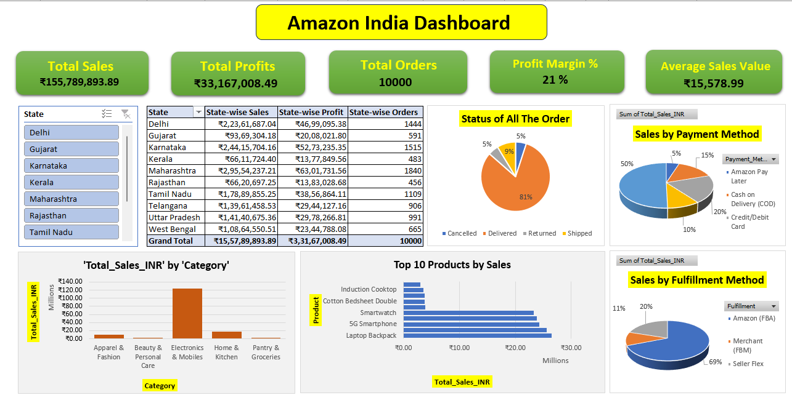

# 📊 Amazon India Sales & Business Performance Dashboard (Excel)

## 📌 Project Overview

The **Amazon India Dashboard** is an Excel-based data analytics project designed to analyze and visualize the overall business performance of Amazon India.

The main objective of this project is to create a simple and interactive dashboard that helps management understand business performance and make data-driven decisions.

The dashboard provides insights into sales, profit, products, orders, customer order status, payment methods, fulfilment methods, and geographic performance through interactive charts, graphs, and Key Performance Indicators (KPIs).

## 🎯 Business Objectives

- Analyze overall sales and profit performance.
- Identify top-performing product categories and products.
- Monitor order status and customer order performance.
- Understand revenue loss caused by returns and cancellations.
- Analyze sales and profit across different payment methods.
- Evaluate fulfilment performance.
- Identify top-performing states based on sales, profit, and orders.

## 📊 Dashboard Features

### 1. Overall Sales & Profit Performance
- Total Sales
- Total Profit
- Total Orders
- Total Units Sold
- Average Order Value (AOV)
- Profit Margin (%)

### 2. Category & Product Performance
- Category-wise Sales
- Category-wise Profit
- Category-wise Units Sold
- Top 10 Products by Sales

### 3. Order Status & Revenue Loss
- Delivered Orders
- Shipped Orders
- Returned Orders
- Cancelled Orders
- Return Rate (%)
- Cancellation Rate (%)
- Category-wise Returns & Cancellations

### 4. Payment, Fulfilment & Geographic Performance
- Sales by Payment Method
- Profit by Payment Method
- Sales by Fulfilment Method
- Profit by Fulfilment Method
- State-wise Sales
- State-wise Profit
- State-wise Orders

## 🛠️ Tools & Technologies Used

- Microsoft Excel
- Pivot Tables
- Pivot Charts
- Slicers & Filters
- Excel Formulas
- Data Cleaning
- Data Analysis
- Data Visualization

## 📁 Project Structure

This project contains one Excel workbook with five separate worksheets:

| Sheet Name | Description                |
|----------|------------------------------|
| Object 1 | First stage of data analysis |
| Object 2 | Second stage of data analysis |
| Object 3 | Third stage of data analysis |
| Object 4 | Fourth stage of data analysis |
| Dashboard | Final interactive dashboard with business insights and visualizations |

**Excel File:** `Amazon India Dashboard.xlsx`

## 🖼️ Dashboard Preview

## 💡 Key Business Insights

This dashboard helps management to:

- Understand overall business performance.
- Identify profitable products and categories.
- Track monthly sales and profit trends.
- Monitor returned and cancelled orders.
- Compare payment and fulfilment methods.
- Identify high-performing states and geographic markets.
- Make better business decisions using data-driven insights.

## 🚀 Project Outcome

Successfully developed an interactive Excel dashboard that converts raw business data into meaningful visual insights.

The dashboard brings important business metrics together in one place, making it easier for non-technical stakeholders to monitor performance and make informed decisions.

## 👨‍💻 Author

**Sayan Maity**

**Project:** Amazon India Sales & Business Performance Dashboard

**Tool:** Microsoft Excel

---

⭐ If you find this project interesting, feel free to explore the repository!